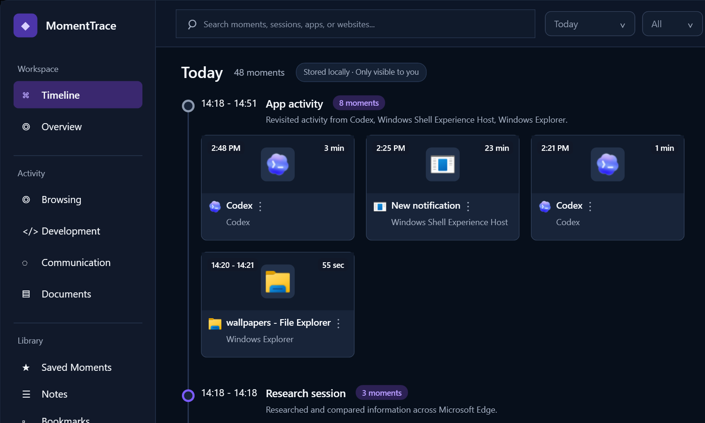

# MomentTrace

MomentTrace is a Windows-first desktop app that builds a private memory timeline of your computer activity. It helps you revisit and recover past work by grouping foreground apps, websites, screenshots, and documents into meaningful local "moments" instead of showing a raw stream of process events.

The long-term goal is a cross-platform desktop timeline for Windows and macOS. The current implementation focuses on a shippable Windows MVP while keeping the core model and storage code separate from Windows-specific integrations.

## Preview



MomentTrace uses a Windows Timeline-inspired workspace: left navigation, date and type filters, grouped horizontal moment sections, compact cards with app icons or website screenshots, and a contextual detail surface. The window has custom chrome with draggable top regions across the shell, plus minimize, taskbar-safe maximize, close-to-tray, and detail-pane controls.


The recorder is session based. It polls the foreground window, keeps the same activity open while the app/window/resource remains active, and collapses repeated sequential entries in the UI so noisy history reads as one continuous moment. Rule-based local classification then groups nearby activity into memory-oriented sessions such as Website browsing, Development work, Communication, Document review, Research session, and Screenshot capture.


MomentTrace now splits recording across long sleep gaps and local day changes, so leaving the app running overnight should start a fresh current-day moment instead of appending indefinitely to yesterday. The UI also refreshes after Windows resumes and checks for date rollover while running.

When browser activity is detected, MomentTrace attempts to capture the active URL with Windows UI Automation and saves a local PNG screenshot only when a new browser session starts.

The **Overview** page gives a lightweight analytics view of the selected day without requiring AI features: summary cards, a 15-minute activity heatmap, top applications, a focus rhythm chart, and day metadata. Activity colours use a fixed semantic palette so browsing, development, documents, apps, system activity, and gaps remain easy to scan across every app theme.


Privacy controls are part of Settings rather than hidden configuration. Recent apps and websites can be selected into block lists, adult-site filtering can be enabled, and manual allow/block domains remain available for fine control.


The Windows installer is built with Inno Setup from a self-contained `win-x64` publish. GitHub Actions can create a downloadable release from a version tag, while the same installer script works locally for test builds.

## Current Features

- Native Windows desktop UI built with WPF
- Grouped timeline with card and list view modes
- Theme system with Midnight, Coffee, Amazon Green, and White Light palettes
- Real alpha transparency control that keeps theme colours while making the app more or less clear
- Overview page with daily activity heatmap and lightweight productivity analytics
- Memory-oriented session grouping into moments rather than raw activity rows
- Rule-based local activity classification for browsing, development, communication, documents, research, and screenshot capture
- Foreground app/window activity recording with session collapsing
- Sleep/resume and day-rollover handling so long-running sessions split cleanly
- Start recording when the app launches
- Optional "Start with Windows" setting
- Minimize-to-tray behavior
- Tray menu for open, pause, resume, and exit
- Timestamped activity history
- Local SQLite storage
- Search, activity type filtering, pinning, and detail view
- Left-rail semantic filters for browsing, development, communication, documents, apps, websites, and files
- Date filtering with Today, Yesterday, then concrete activity dates
- Auto-refreshing date filters after Windows resume and local day changes
- Real app icon extraction when executable metadata is available
- Browser URL capture and local screenshot previews
- Privacy filters with recent app/website selection, adult website filtering, optional cached blocklist updates, and manual allow/block lists
- Local activity export and delete controls for user-owned history cleanup
- Single-instance behavior that brings the running app back when launched again
- Noise filtering for MomentTrace itself and Windows lock-screen activity
- Themed Settings modal with startup, recording, timeline view mode, appearance, and privacy controls
- "Where I Live" diagnostics for install, database, settings, and screenshot locations
- Custom title bars for the main app and Settings, including taskbar-safe maximize behavior
- Optional AI provider abstraction for future summaries and insights

## Project Structure

```text
MomentTrace.slnx
├─ MomentTrace.App       WPF app shell, UI, tray icon, settings wiring
├─ MomentTrace.Core      Shared models, interfaces, local classification/search/session services
├─ MomentTrace.MacProbe  First macOS recorder probe for active app/window capture
├─ MomentTrace.Storage   SQLite persistence
└─ MomentTrace.Windows   Windows foreground recorder and startup registration
```

This split is intentional. Future macOS support should add platform-specific services beside `MomentTrace.Windows` while reusing `MomentTrace.Core` and `MomentTrace.Storage`.

## Requirements

- Windows 10 or later
- .NET SDK 8 or later
- Visual Studio 2022 with the **.NET desktop development** workload, or the `dotnet` CLI

## Build

From the repository root:

```powershell
dotnet build .\MomentTrace.slnx
```

## Run During Development

Run the desktop app:

```powershell
dotnet run --project .\MomentTrace.App\MomentTrace.App.csproj
```

Launch minimized to the tray:

```powershell
dotnet run --project .\MomentTrace.App\MomentTrace.App.csproj -- --minimized
```

In Visual Studio, open `MomentTrace.slnx`, set `MomentTrace.App` as the startup project, and press `F5`.

## macOS Probe

MomentTrace includes an early macOS recorder probe so the Mac capture model can be tested before the full UI is ported. It reuses `MomentTrace.Core` and `MomentTrace.Storage`, writes to the same SQLite schema, and records:

- active app name
- process id as a local resource marker
- active window title when macOS permissions allow it
- start/end timestamps

Run it on a Mac from the repository root:

```bash
dotnet run --project ./MomentTrace.MacProbe/MomentTrace.MacProbe.csproj
```

The first run may require macOS privacy approval for Terminal, Visual Studio, or the launched host process to control System Events and read accessibility metadata. The probe intentionally avoids screenshots and browser URL capture for now so we can prove the lowest-permission recorder path first.

On non-macOS machines, the project builds but exits with a message instead of recording.

### Pull And Run On A Mac

Use GitHub as the bridge between Windows and macOS rather than building from a Windows network share. Local Mac builds are faster and avoid `bin`/`obj` file-locking problems across SMB.

From Terminal on the Mac:

```bash
git clone https://github.com/nwaoga/MomentTrace.git
cd MomentTrace
dotnet build ./MomentTrace.slnx
dotnet run --project ./MomentTrace.MacProbe/MomentTrace.MacProbe.csproj
```

If the repo is already cloned:

```bash
cd MomentTrace
git pull
dotnet build ./MomentTrace.slnx
dotnet run --project ./MomentTrace.MacProbe/MomentTrace.MacProbe.csproj
```

For the first Mac spike, Terminal is the simplest way to run the probe because the output is immediate and permission prompts are easier to reason about. Visual Studio Code is the best lightweight IDE for editing and debugging on macOS. Visual Studio for Mac is discontinued, so do not plan the Mac workflow around it. If using a full JetBrains IDE, Rider is a good option once the cross-platform UI work starts.

## Local Data

MomentTrace stores user data locally:

```text
%AppData%\MomentTrace\timeline.db
%AppData%\MomentTrace\settings.json
%AppData%\MomentTrace\screenshots\
%AppData%\MomentTrace\privacy-blocklists\
```

Older prototype data from `%AppData%\NwaogaTimeline` is copied into the new MomentTrace folder the first time the renamed app runs.

The app currently keeps captured history on the local machine. The database, screenshots, settings, and cached privacy blocklists are intentionally stored under the user's AppData folder so privacy controls can delete, export, or exclude activity without depending on a cloud service.

## Startup Behavior

The in-app **Start with Windows** checkbox writes a per-user startup entry to:

```text
HKCU\Software\Microsoft\Windows\CurrentVersion\Run
```

The startup command launches MomentTrace with `--minimized`, so recording starts quietly and the app lives in the tray.

MomentTrace also uses a single-instance guard. If the app is already running, launching it again signals the existing instance and brings the current window back instead of opening a duplicate recorder.

## Timeline And Overview

The Timeline page is the memory explorer. It shows moments grouped by `Today`, `Yesterday`, then dated sections, with card and list modes controlled from Settings.

Cards are organized into semantic sessions using deterministic local rules. For example, nearby browser pages can become `Website browsing` or `Research session`, code editors and terminals become `Development work`, messaging tools become `Communication`, document tools become `Document review`, and Snipping Tool activity becomes `Screenshot capture`.

Large groups show a compact preview first. `View all` expands that session inline and changes to `Show less`, keeping the timeline readable while still allowing detailed recovery.

The left rail can filter the Timeline by semantic Activity views (`Browsing`, `Development`, `Communication`, `Documents`) or raw Sources (`Apps`, `Websites`, `Files`). Active filters are highlighted in the rail and echoed as a small badge in the Timeline header. Selecting `Timeline` clears the rail filter and returns to all moments.

The Library section uses a simple saved-memory model:

- `Pin` keeps a moment prominent in the Timeline.
- `Bookmark` saves a moment as a reusable Library reference.
- `Note` adds human context to a moment.
- `Saved Moments` shows anything pinned, bookmarked, or noted.
- `Notes` shows moments with notes.
- `Bookmarks` shows bookmarked moments.

The Overview page is the activity analytics view. It summarizes the selected date with:

- Remembered/foreground span, session count, most-seen app, and longest visible run
- A horizontal 15-minute heatmap inspired by GitHub contribution graphs and screen-time tools
- Top applications with seen time, session count, percentage of captured foreground time, and a simple trend column
- A lightweight focus timeline showing active blocks and gaps
- A right sidebar for day totals, quick filters, and category legend

Overview intentionally avoids raw event lists so it does not duplicate Timeline.

## Themes And Appearance

MomentTrace currently ships with four app themes:

- `Midnight (Dark)`
- `Coffee (Light)`
- `Amazon Green (Dark)`
- `White Light`

Themes use six base colour roles: `Base`, `Surface`, `Text`, `MutedText`, `Accent`, and `Stroke`. The app derives supporting colours such as raised surfaces, soft accent, rail/detail surfaces, and contrast-aware accent text from those roles. This keeps the current themes consistent and leaves a clear path for future custom theme creation.

Overview activity colours are intentionally separate from the app theme. They use a fixed semantic palette for activity types so the heatmap, focus rhythm, quick filters, and legend remain readable in both dark and light themes.

The transparency slider changes real window alpha rather than merely lightening or darkening colours. Custom chrome is used for a cleaner desktop shell, and maximize behavior is constrained to the Windows work area so the app does not cover the taskbar.

## Local Classification And Search

MomentTrace is designed so AI can be layered in later, but the current MVP is fully local and deterministic. The Core project includes these extension points:

```csharp
IActivityClassifier
ISessionSummarizer
ISearchProvider
IInsightProvider
```

Current implementations are rule-based:

- `RuleBasedActivityClassifier` maps apps, processes, titles, and URLs to semantic categories.
- `RuleBasedSessionSummarizer` gives sessions human-readable names and descriptions.
- `LocalMetadataSearchProvider` searches local metadata, category labels, titles, apps, and URLs.
- `LocalInsightProvider` returns simple local-only metadata insights.

There are no LLM, embedding, vector database, or cloud dependencies in the app today.

## Recording Model

The Windows recorder lives in `MomentTrace.Windows` and currently:

- Polls the foreground window every few seconds
- Opens a new timeline activity when the active app, title, or browser URL changes
- Extends the current activity while the same item remains active
- Throttles duration updates to reduce database writes
- Captures browser screenshots only when a new browser session starts
- Splits active sessions when the date changes or the machine resumes after a long gap
- Closes the active session cleanly when recording stops or the app exits
- Excludes MomentTrace itself and default Windows lock-screen activity from new recordings
- Excludes configured private websites and blocked apps before saving activity or capturing screenshots

Existing stored MomentTrace and lock-screen rows are also filtered out of the Timeline and Overview views without requiring a database cleanup.

## Privacy Controls

MomentTrace treats privacy as part of the product experience:

- Activity history is stored locally in SQLite.
- Screenshots are stored locally under AppData.
- Adult website filtering happens before data is saved or screenshotted.
- Manual always-block and always-allow domain lists are available in Settings.
- Recent apps and websites are shown as selectable privacy lists so the user can block future captures without typing exact process names or domains.
- User-blocked apps are skipped before new activity rows are saved.
- Optional adult blocklist updates are cached locally under `%AppData%\MomentTrace\privacy-blocklists\`.
- Timeline and Overview hide matching privacy-filtered rows from existing history without deleting the database.
- Local activity can be exported to JSON from Settings before cleanup.
- Local activity can be deleted from Settings, including cached MomentTrace screenshot and thumbnail previews. Settings and privacy blocklists are kept.

## AI Extensibility

MomentTrace has an optional `IAiProvider` abstraction in `MomentTrace.Core` for future features:

```csharp
Task<string> GetDailySummaryAsync(IReadOnlyList<TimelineActivity> activities, CancellationToken cancellationToken = default);
Task<IReadOnlyList<string>> GetProductivityInsightsAsync(IReadOnlyList<TimelineActivity> activities, CancellationToken cancellationToken = default);
```

No AI provider is registered today. AI summaries, recommendations, and conversational UI must only render when an AI provider exists. Without a provider, the app should feel complete and simply hide those surfaces. Current classification, session naming, search, and local insights are deterministic.

## Publish A Standalone Windows Build

```powershell
dotnet publish .\MomentTrace.App\MomentTrace.App.csproj `
  -c Release `
  -r win-x64 `
  --self-contained true `
  -p:PublishSingleFile=true `
  -p:IncludeNativeLibrariesForSelfExtract=true `
  -o .\publish\win-x64
```

The published executable is written to:

```text
publish\win-x64\MomentTrace.App.exe
```

MomentTrace includes a project-owned app icon at `MomentTrace.App\Assets\MomentTrace.ico`. The icon is embedded into the published executable and is also used by the WPF window, tray icon, installer, Start Menu shortcut, and uninstall entry.

## Build The Windows Installer

MomentTrace uses Inno Setup for the Windows installer. The installer is machine-wide and installs to:

```text
C:\Program Files\MomentTrace
```

Because the installer writes to Program Files, installing or uninstalling requires administrator approval. Install [Inno Setup 6](https://jrsoftware.org/isinfo.php), then run:

```powershell
.\scripts\build-installer.ps1 -Version 0.1.0
```

The setup executable is written to:

```text
dist\MomentTrace-0.1.0-win-x64-setup.exe
```

The installer creates a Start Menu shortcut, optionally creates a Desktop shortcut, uses the MomentTrace icon, launches the app after install when selected, and registers a normal Windows uninstall entry. During uninstall it stops the running app if needed and removes MomentTrace startup registry values for `MomentTrace` and the legacy `Nwaoga Timeline` value.

Local history and settings under `%AppData%\MomentTrace` are intentionally left in place for now so uninstalling the app does not accidentally delete the user's timeline. Full local data deletion should be handled by an explicit privacy cleanup control in the app rather than by default uninstall behavior.

## CI And Releases

GitHub Actions are used for build checks and downloadable releases:

- `.github/workflows/ci.yml` builds the solution on pushes and pull requests to `main`.
- `.github/workflows/release.yml` creates a versioned Windows installer plus a portable zip and attaches both to a GitHub Release.

To create a release from Git:

```powershell
git tag v0.1.0
git push origin v0.1.0
```

The release workflow validates the `vMAJOR.MINOR.PATCH` tag format, publishes the app as a self-contained Windows `win-x64` build, stamps the assembly/file version, creates a setup executable named like `MomentTrace-0.1.0-win-x64-setup.exe`, creates a portable zip named like `MomentTrace-0.1.0-win-x64.zip`, and uploads both to the GitHub Release.

You can also run the **Release** workflow manually in GitHub Actions and provide a version such as `v0.1.0`.

For Azure DevOps planning, current implementation work is tracked in the MomentTrace project and commits can reference work items with `AB#<id>` in the commit message.

## Development Notes

- Keep platform-neutral logic in `MomentTrace.Core` and `MomentTrace.Storage`.
- Keep Windows API, registry, tray, and executable-icon behavior in `MomentTrace.Windows` or `MomentTrace.App`.
- Keep optional AI features behind `IAiProvider`; do not show AI panels when no provider is registered.
- Keep captured user data local-first unless a future feature explicitly asks for sync.
- Do not commit `bin`, `obj`, `.vs`, `publish`, or local user settings.
- Treat privacy as a product feature: activity history is local-first, and future recording controls should make data capture obvious and user-controlled.

## Roadmap

- Refresh README screenshots so every preview reflects the current themed UI
- Add filter counts, persisted filter preferences, and richer empty states
- Add saved moments, notes, and bookmarks as real library features
- Add privacy controls for deleting and exporting activity
- Add a settings option to delete local data when the user wants a full privacy cleanup
- Add app health/status checks for recorder, screenshot capture, browser URL capture, and database writes
- Add first-run onboarding for privacy, startup behavior, and local storage
- Plan the cross-platform desktop path, likely with Avalonia for Windows/macOS UI reuse
