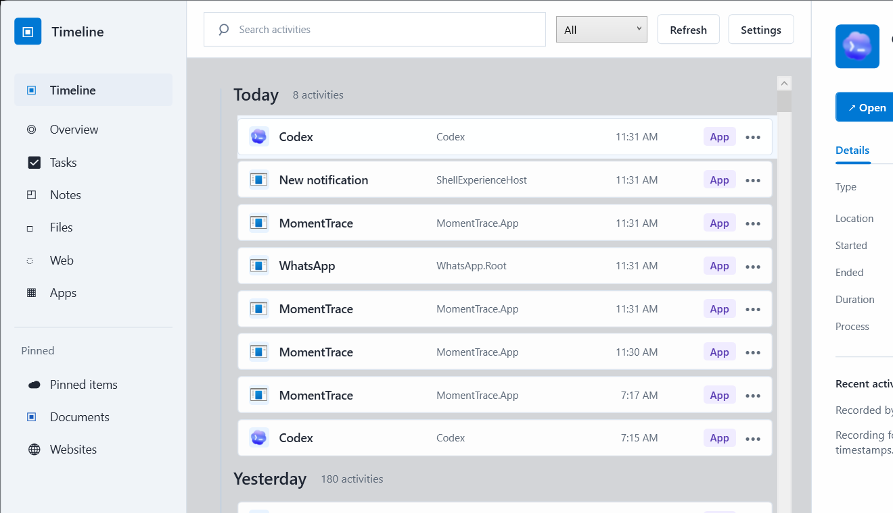

# MomentTrace

MomentTrace is a Windows-first desktop app that builds a private timeline of your computer activity. It records the foreground app/window with timestamps, stores the history locally in SQLite, and keeps running quietly from the Windows system tray.

The long-term goal is a cross-platform desktop timeline for Windows and macOS. The current implementation focuses on a shippable Windows MVP while keeping the core model and storage code separate from Windows-specific integrations.

## Preview



MomentTrace runs quietly in the Windows tray and records foreground app/window activity with timestamps. The app stores the timeline locally in SQLite, then lets you search, filter, pin, and inspect each activity from the desktop UI.


When browser activity is detected, MomentTrace attempts to capture the active URL with Windows UI Automation. Browser activities can also save local PNG screenshots under `%AppData%\MomentTrace\screenshots`, which gives the future card view visual previews while keeping captured data on the user's machine.

## Current Features

- Native Windows desktop UI built with WPF
- Foreground app/window activity recording
- Start recording when the app launches
- Optional "Start with Windows" setting
- Minimize-to-tray behavior
- Tray menu for open, pause, resume, and exit
- Timestamped activity history
- Local SQLite storage
- Search, activity type filtering, pinning, and detail view
- Real app icon extraction when executable metadata is available
- Transparent desktop window with an in-app transparency slider

## Project Structure

```text
MomentTrace.slnx
├─ MomentTrace.App       WPF app shell, UI, tray icon, settings wiring
├─ MomentTrace.Core      Shared models, interfaces, activity classification
├─ MomentTrace.Storage   SQLite persistence
└─ MomentTrace.Windows   Windows foreground recorder and startup registration
```

This split is intentional. Future macOS support should add platform-specific services beside `MomentTrace.Windows` while reusing `MomentTrace.Core` and `MomentTrace.Storage`.

## Requirements

- Windows 10 or later
- .NET SDK 8 or later
- Visual Studio 2022 with the **.NET desktop development** workload, or the `dotnet` CLI

## Build

From the repository root:

```powershell
dotnet build .\MomentTrace.slnx
```

## Run During Development

Run the desktop app:

```powershell
dotnet run --project .\MomentTrace.App\MomentTrace.App.csproj
```

Launch minimized to the tray:

```powershell
dotnet run --project .\MomentTrace.App\MomentTrace.App.csproj -- --minimized
```

In Visual Studio, open `MomentTrace.slnx`, set `MomentTrace.App` as the startup project, and press `F5`.

## Local Data

MomentTrace stores user data locally:

```text
%AppData%\MomentTrace\timeline.db
%AppData%\MomentTrace\settings.json
```

Older prototype data from `%AppData%\NwaogaTimeline` is copied into the new MomentTrace folder the first time the renamed app runs.

## Startup Behavior

The in-app **Start with Windows** checkbox writes a per-user startup entry to:

```text
HKCU\Software\Microsoft\Windows\CurrentVersion\Run
```

The startup command launches MomentTrace with `--minimized`, so recording starts quietly and the app lives in the tray.

## Publish A Standalone Windows Build

```powershell
dotnet publish .\MomentTrace.App\MomentTrace.App.csproj `
  -c Release `
  -r win-x64 `
  --self-contained true `
  -p:PublishSingleFile=true `
  -p:IncludeNativeLibrariesForSelfExtract=true `
  -o .\publish\win-x64
```

The published executable is written to:

```text
publish\win-x64\MomentTrace.App.exe
```

## CI And Releases

GitHub Actions are used for build checks and downloadable releases:

- `.github/workflows/ci.yml` builds the solution on pushes and pull requests to `main`.
- `.github/workflows/release.yml` creates a versioned Windows zip and attaches it to a GitHub Release.

To create a release from Git:

```powershell
git tag v0.1.0
git push origin v0.1.0
```

The release workflow validates the `vMAJOR.MINOR.PATCH` tag format, publishes the app as a self-contained Windows `win-x64` build, stamps the assembly/file version, creates a zip named like `MomentTrace-0.1.0-win-x64.zip`, and uploads it to the GitHub Release.

You can also run the **Release** workflow manually in GitHub Actions and provide a version such as `v0.1.0`.

## Development Notes

- Keep platform-neutral logic in `MomentTrace.Core` and `MomentTrace.Storage`.
- Keep Windows API, registry, tray, and executable-icon behavior in `MomentTrace.Windows` or `MomentTrace.App`.
- Do not commit `bin`, `obj`, `.vs`, `publish`, or local user settings.
- Treat privacy as a product feature: activity history is local-first, and future recording controls should make data capture obvious and user-controlled.

## Roadmap

- Harden long-running Windows recording behavior
- Improve the timeline and card-style views
- Add privacy controls for deleting, exporting, and excluding activity
- Create a proper Windows installer with icon, shortcuts, and uninstall support
- Plan the cross-platform desktop path, likely with Avalonia for Windows/macOS UI reuse
