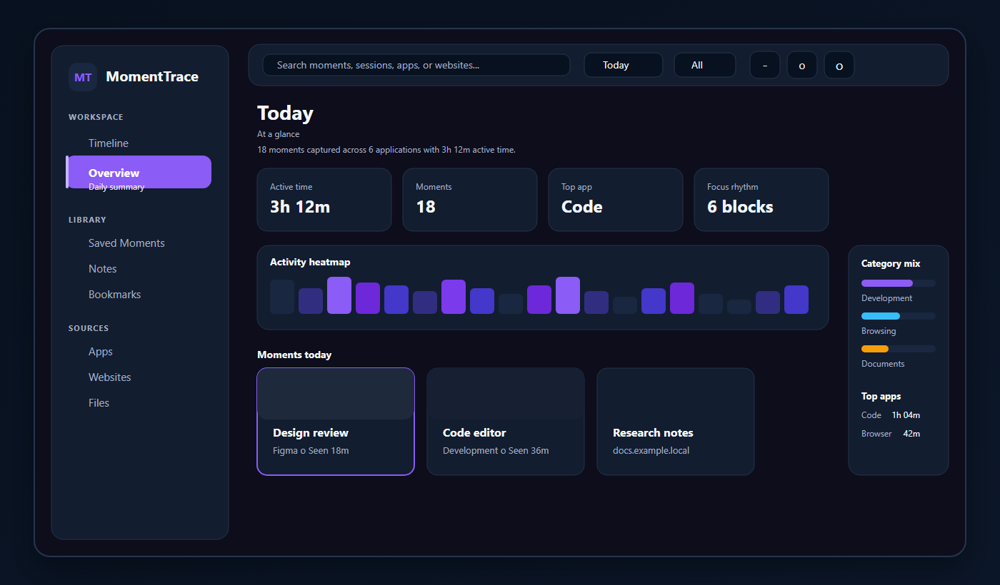
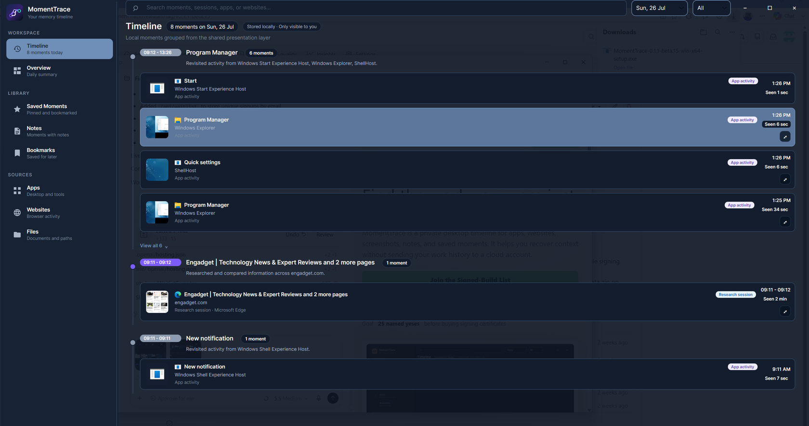
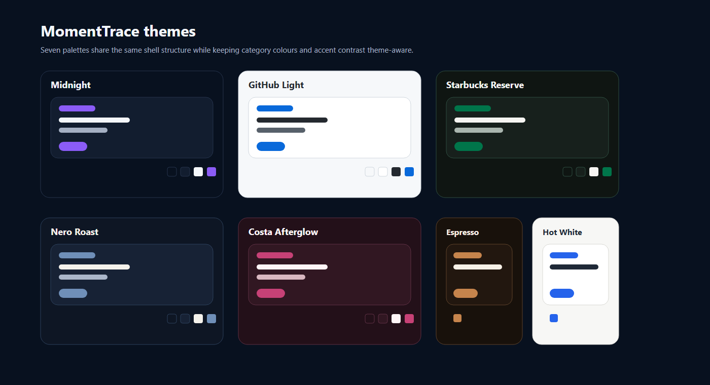
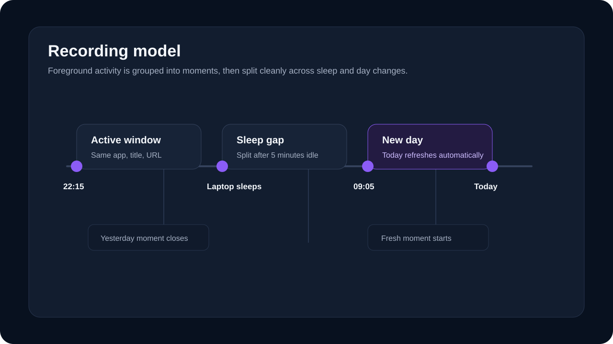
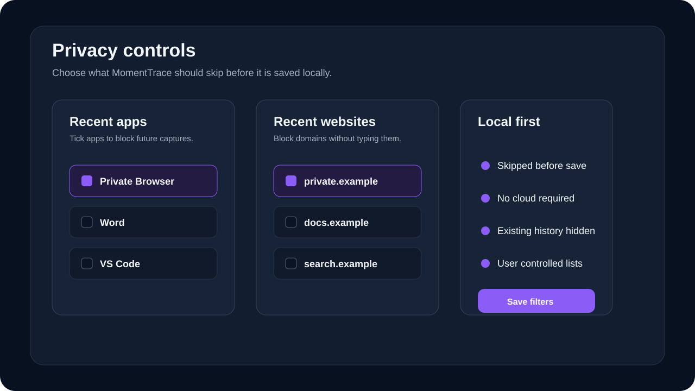
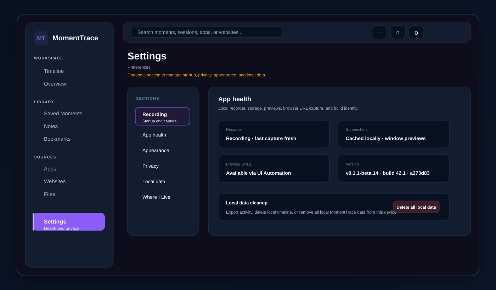
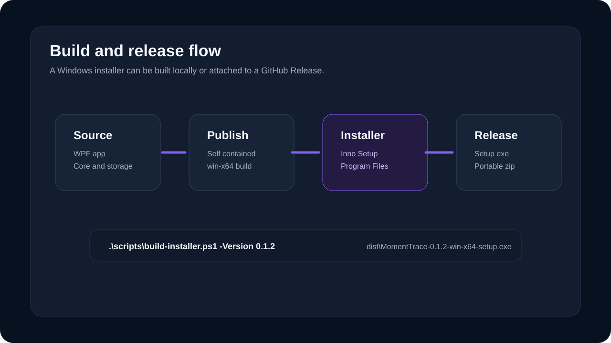

# MomentTrace

MomentTrace is a Windows-first desktop app that builds a private memory timeline of your computer activity. It helps you revisit and recover past work by grouping foreground apps, websites, screenshots, and documents into meaningful local "moments" instead of showing a raw stream of process events.

The long-term goal is a cross-platform desktop timeline for Windows and macOS. The current implementation focuses on a shippable Windows MVP while keeping the core model and storage code separate from Windows-specific integrations.

For active roadmap, Azure DevOps mapping, QA priorities, and current risks, see [`ai/project-plan.md`](ai/project-plan.md).
For launch positioning, website copy, social posts, demo script, and beta checklist, see [`docs/marketing-launch-kit.md`](docs/marketing-launch-kit.md).
For a static landing page draft, open [`docs/landing/index.html`](docs/landing/index.html).

## Preview



MomentTrace uses a Windows Timeline-inspired workspace with a more visual daily-story layer on top: Workspace, Library, and Sources navigation, date and type filters, grouped moment sections, compact cards with app icons or website screenshots, custom shell chrome, and the Overview daily story dashboard. The preview above uses sanitized demo activity rather than a live personal timeline.

### More Screens





The recorder is session based. It polls the foreground window, keeps the same activity open while the app/window/resource remains active, and collapses repeated sequential entries in the UI so noisy history reads as one continuous moment. Rule-based local classification then groups nearby activity into memory-oriented sessions such as Website browsing, Development work, Communication, Document review, Research session, and Screenshot capture.



MomentTrace now splits recording across long sleep gaps and local day changes, so leaving the app running overnight should start a fresh current-day moment instead of appending indefinitely to yesterday. The UI also refreshes after Windows resumes and checks for date rollover while running.

When browser activity is detected, MomentTrace attempts to capture the active URL with Windows UI Automation and saves a local PNG screenshot only when a new browser session starts.

The **Overview** page now behaves like a more visual daily-story dashboard without requiring AI features. The current Avalonia work includes summary cards, a theme-aware 15-minute activity heatmap, key-moment cards, category breakdown charts, top applications, and a focus-rhythm strip, all sourced from the existing local activity store. Activity colours keep stable category meaning while adapting to the selected workspace theme, and the overview surfaces now degrade more gracefully on empty and low-activity days.



Privacy controls are part of Settings rather than hidden configuration. Recent apps and websites can be selected into block lists, adult-site filtering can be enabled, and manual allow/block domains remain available for fine control.

On first run, MomentTrace explains the local-first storage model, keeps adult-site filtering enabled by default, and lets the user choose whether the app should start automatically at sign-in.





The Windows installer is built with Inno Setup from a self-contained `MomentTrace.Desktop` `win-x64` publish. GitHub Actions creates Windows and macOS artifacts from the same version tag, while the local installer script still works for test builds.

## Current Features

- Native Windows desktop UI built with WPF
- Avalonia desktop shell in active parity work, sharing timeline, overview, detail-pane, and shell presentation layers across Windows/macOS targets
- macOS Avalonia shell now uses native traffic-light controls, Command-key shortcuts, and titlebar-blended surfaces so the top chrome feels more at home on Mac
- Avalonia Windows target now starts the Windows foreground recorder, reads the shared local SQLite timeline, and refreshes the shell as new activity arrives
- Grouped timeline with card and list view modes in both the WPF app and Avalonia shell
- Theme system with Midnight, GitHub Light, Starbucks Reserve, Nero Roast, Costa Afterglow, Espresso (Mono), and Hot White palettes
- Real alpha transparency control that keeps theme colours while making the app more or less clear
- Overview page with daily activity heatmap and lightweight productivity analytics
- Designed empty and low-data overview states so sparse days still feel intentional
- Memory-oriented session grouping into moments rather than raw activity rows
- Rule-based local activity classification for browsing, development, communication, documents, research, and screenshot capture
- Foreground app/window activity recording with session collapsing
- Sleep/resume and day-rollover handling so long-running sessions split cleanly
- Start recording when the app launches
- Optional start-at-sign-in setting
- First-run onboarding for privacy, startup behavior, and local storage expectations
- Minimize-to-tray behavior
- Tray menu for open, pause, resume, and exit
- Timestamped activity history
- Local SQLite storage
- Search, activity type filtering, pinning, and detail view
- Left-rail filters for Library (saved moments, notes, bookmarks) and Sources (apps, websites, files)
- Date filtering with Today, Yesterday, then concrete activity dates
- Auto-refreshing date filters after Windows resume and local day changes
- Real app icon extraction when executable metadata is available, including platform-specific Windows icon resolution for classic and packaged apps
- Browser URL capture plus local screenshot and thumbnail previews for captured moments
- Privacy filters with recent app/website selection, adult website filtering, optional cached blocklist updates, and manual allow/block lists
- Local activity export, activity deletion, and full local-data cleanup controls for user-owned history cleanup
- Single-instance behavior that brings the running app back when launched again
- Noise filtering for MomentTrace itself and Windows lock-screen activity
- Themed Settings modal with startup, recording, timeline view mode, appearance, and privacy controls
- Settings app health panel for recorder availability, database readability, screenshot cache, icon cache, settings file, and privacy exclusion status
- "Where I Live" diagnostics for install, database, settings, and screenshot locations
- Custom title bars, top command surfaces, and themed confirmation modals for the main app and Settings
- Warning-free solution build across the current Windows/Avalonia project set
- Optional AI provider abstraction for future summaries and insights

## Project Structure

```text
MomentTrace.slnx
├─ MomentTrace.App           WPF app shell, UI, tray icon, settings wiring
├─ MomentTrace.Core          Shared models, interfaces, local classification/search/session services
├─ MomentTrace.Desktop       Avalonia desktop shell for Windows/macOS UI reuse and parity work
├─ MomentTrace.Mac           macOS foreground recorder and capture service
├─ MomentTrace.Presentation  Shared memory/timeline view models and shell service contracts
├─ MomentTrace.Storage       SQLite persistence
└─ MomentTrace.Windows       Windows foreground recorder and startup registration
```

This split is intentional. Future macOS support should add platform-specific services beside `MomentTrace.Windows` while reusing `MomentTrace.Core`, `MomentTrace.Storage`, and the platform-neutral presentation models.

`MomentTrace.Presentation` is the first major cross-platform extraction. It now owns the platform-neutral shaping for:

- moment display text, categories, durations, and saved-state labels
- timeline session collapsing and grouped session presentation
- Overview analytics including summary metrics, heatmap segments, top applications, focus blocks, and activity legend colours
- Today, Yesterday, and dated filter options
- detail-panel narrative text, grouped raw entries, and related moment selection
- shell contracts for app icons, local paths, and user profile metadata

The WPF app now acts more like a Windows shell over shared timeline data. It still owns WPF controls, some legacy tray/startup wiring, custom window chrome, Windows icons, screenshot previews, settings, and installer/startup wiring.

`MomentTrace.Desktop` is the active Avalonia shell for cross-platform UI work. It targets both `net8.0` and `net8.0-windows`, reads the same local SQLite timeline through `MomentTrace.Storage`, and binds timeline groups, Overview analytics, and the right-side detail surface from `MomentTrace.Presentation`. The Windows target now starts the shared Windows foreground recorder, shows local screenshot previews, resolves real app icons through `MomentTrace.Windows`, supports single-instance reopen behavior, provides tray/background behavior for the shipped Windows shell, and refreshes the UI when new activity lands. On macOS, the shell now defers to native traffic-light window controls, keeps the titlebar visually blended with the app surface, wires common Command-key shortcuts like settings, search, and close, and uses a menu bar status item as the background-running equivalent of the Windows tray icon. Custom chrome remains in use for the Windows shell, delete confirmations, and the first Settings health/status panel. Main window creation now happens before background recorder startup so the Avalonia shell appears reliably even if recorder initialization is slow. Installer packaging and the remaining Windows startup integration still live in `MomentTrace.App` and `MomentTrace.Windows`.

## Requirements

- Windows 10 or later
- .NET SDK 8 or later
- Visual Studio 2022 with the **.NET desktop development** workload, or the `dotnet` CLI

## Build

From the repository root:

```powershell
dotnet build .\MomentTrace.slnx
```

## Run During Development

Run the desktop app:

```powershell
dotnet run --project .\MomentTrace.App\MomentTrace.App.csproj
```

Run the Avalonia shell:

```powershell
dotnet run --project .\MomentTrace.Desktop\MomentTrace.Desktop.csproj
```

Run the Avalonia shell with the Windows recorder and Windows app-icon provider:

```powershell
dotnet run --project .\MomentTrace.Desktop\MomentTrace.Desktop.csproj -f net8.0-windows
```

Launch minimized to the tray:

```powershell
dotnet run --project .\MomentTrace.App\MomentTrace.App.csproj -- --minimized
```

In Visual Studio, open `MomentTrace.slnx`, set `MomentTrace.App` as the startup project, and press `F5`.

## macOS Platform Service

MomentTrace includes a first-class `MomentTrace.Mac` platform service for active app/window capture. It is wired into the Avalonia desktop shell on macOS, reuses `MomentTrace.Core` and `MomentTrace.Storage`, writes to the same SQLite schema, and records:

- active app name
- bundle identifier when available
- executable path when available
- stable app resource identity, preferring `app://<bundle-id>` and then app path before falling back to `pid:`
- browser URL capture for Safari and Chromium-family browsers when AppleScript access is available
- active window title when macOS permissions allow it
- local screenshot and thumbnail paths when macOS Screen Recording permission allows capture, preferring the real frontmost window ID (`screencapture -l`) and falling back to Accessibility window bounds when needed
- start/end timestamps

The packaging, signing, notarization, and DMG release path is tracked in [docs/macos-release.md](docs/macos-release.md).

Run the Avalonia shell on a Mac from the repository root:

```bash
dotnet run --project ./MomentTrace.Desktop/MomentTrace.Desktop.csproj -f net8.0
```

The first run may require macOS privacy approval for Terminal, Visual Studio Code, Rider, or the launched host process to control System Events, read accessibility metadata, capture screenshots, and read browser tab URLs through AppleScript where supported.

On non-macOS machines, the desktop shell builds without starting the macOS recorder.

Verified macOS Platform Service result:

- Tested from `/Users/blakboi/Documents/Codex/2026-05-30/help-me-build-this-users-blakboi/work/MomentTrace-verify`
- .NET SDK `9.0.315`
- .NET Runtime `8.0.28`
- Shared timeline database: `~/Library/Application Support/MomentTrace/timeline.db`
- Confirmed foreground app/window rows were written for Codex
- Confirmed the latest row populated `bundle_identifier` and switched `resource` to `app://com.openai.codex`
- Confirmed the latest screenshot capture was cropped to the frontmost app window instead of the full display
- Confirmed Safari rows can now store real `https://...` page URLs for reopen instead of only reopening the browser app

### Pull And Run On A Mac

Use GitHub as the bridge between Windows and macOS rather than building from a Windows network share. Local Mac builds are faster and avoid `bin`/`obj` file-locking problems across SMB.

From Terminal on the Mac:

```bash
git clone https://github.com/nwaoga/MomentTrace.git
cd MomentTrace
dotnet build ./MomentTrace.slnx -p:EnableWindowsTargeting=true
dotnet run --project ./MomentTrace.Desktop/MomentTrace.Desktop.csproj -f net8.0
```

Quick checklist for the Mac run:

- Install the .NET SDK first.
- Keep `-p:EnableWindowsTargeting=true` on solution builds because the repo still includes the Windows project.
- If macOS prompts for Accessibility or Screen Recording permissions, allow them and rerun the desktop shell.
- Switch between a few apps with visible windows, such as Finder, Terminal, Safari, Codex, or System Settings.
- Confirm new foreground rows appear in the local database as you switch between apps.
- Confirm rows are written under `~/Library/Application Support/MomentTrace/timeline.db`.
- Confirm recorded rows now prefer stable app identity such as `app://com.apple.finder` instead of raw `pid:` markers when bundle IDs are available.
- Confirm Safari and supported Chromium browsers store real page URLs in `resource` when browser scripting access is available.
- Confirm screenshot and thumbnail files appear under `~/Library/Application Support/MomentTrace/screenshots` and `~/Library/Application Support/MomentTrace/thumbnails` when Screen Recording is allowed.
- Confirm new screenshots capture the frontmost app window by window ID when possible, with Accessibility rectangle crop as fallback.

If the repo is already cloned:

```bash
cd MomentTrace
git pull
dotnet build ./MomentTrace.slnx -p:EnableWindowsTargeting=true
dotnet run --project ./MomentTrace.Desktop/MomentTrace.Desktop.csproj -f net8.0
```

If building the whole solution on macOS, include Windows targeting because the solution still contains the Windows WPF project:

```bash
dotnet build ./MomentTrace.slnx -p:EnableWindowsTargeting=true
```

Terminal is the simplest way to run the macOS shell during validation because permission prompts are easier to reason about. Visual Studio Code is the best lightweight IDE for editing and debugging on macOS. Visual Studio for Mac is discontinued, so do not plan the Mac workflow around it. If using a full JetBrains IDE, Rider is a good option.

### Mac Validation Checklist

Use this when you want a quick pass/fail validation on a real Mac after pulling the latest branch, then paste the results back into this Codex thread for review.

1. Build the macOS service or the solution:

```bash
dotnet build ./MomentTrace.Mac/MomentTrace.Mac.csproj
dotnet build ./MomentTrace.slnx -p:EnableWindowsTargeting=true
```

2. Run the Avalonia shell with the macOS service:

```bash
dotnet run --project ./MomentTrace.Desktop/MomentTrace.Desktop.csproj -f net8.0
```

3. Interact with a few apps for 20 to 40 seconds:

- Finder
- Terminal
- Safari or Chrome
- System Settings

4. Verify activity capture:

- New foreground changes should be written to the local timeline database.
- Window titles may be blank or reduced until Accessibility permission is granted.

5. Verify stored data:

```bash
sqlite3 "$HOME/Library/Application Support/MomentTrace/timeline.db" "select started_at, app_name, bundle_identifier, resource, executable_path, screenshot_path, thumbnail_path from activities order by id desc limit 10;"
```

6. Paste these two artifacts back into Codex:

- a note on which apps you switched through while the desktop shell was running
- the SQLite query result from the command above

Suggested capture format:

```text
Apps exercised:
Finder, Safari, System Settings

SQLite:
2026-06-17T14:32:18.0000000+01:00 | Safari | com.apple.Safari | https://openai.com/ | /Applications/Safari.app | /Users/.../screenshots/...png | /Users/.../thumbnails/...jpg
```

Expected validation result:

- `app_name` is populated.
- `bundle_identifier` is populated for normal bundled apps such as Finder or System Settings.
- `resource` prefers real `http`/`https` page URLs for supported browsers, otherwise it prefers `app://...` when `bundle_identifier` exists.
- `executable_path` points to the `.app` bundle contents or executable path when macOS exposes it.
- `screenshot_path` and `thumbnail_path` are populated after Screen Recording permission is granted.

If validation fails:

- No new rows usually means the desktop shell never became active long enough, the app lacked macOS permissions, or the shell was not running on macOS.
- Missing titles usually means Accessibility permission was not granted yet.
- Missing screenshots usually means Screen Recording permission was not granted yet.
- Repeated `pid:` resources are acceptable only for apps where bundle ID and path could not be resolved.

### Latest Mac Verification

Date:

```text
2026-06-18
```

Machine / environment:

```text
Mac model: unavailable from sandboxed shell
macOS version: 26.4.1
.NET SDK: 9.0.315
Branch: main
Commit: 42323be69e4e31a2f1679fc3f33e22afcb8ddfb0
```

Archived standalone-recorder output from the earlier validation run:

```text
11:31:15 Codex - Codex
11:32:31 Safari - Google
11:33:00 Safari - Internet Speed Test | Fast.com
11:34:40 Safari - GitHub
11:41:27 Safari - ChatGPT
```

SQLite verification query:

```bash
sqlite3 "$HOME/Library/Application Support/MomentTrace/timeline.db" "select started_at, app_name, bundle_identifier, resource, executable_path, screenshot_path, thumbnail_path from activities order by id desc limit 10;"
```

SQLite verification result:

```text
2026-06-18T14:16:45.9910680+01:00 | Safari | com.apple.Safari | https://chatgpt.com/g/g-p-6a2b054e8d788191883dc31d7e265708/c/6a176763-1428-83eb-af73-1a053643a332 | /Applications/Safari.app | /Users/blakboi/Library/Application Support/MomentTrace/screenshots/20260618-141646-424-8cf8c990705f4128a5f4456c2ca54cb6.png | /Users/blakboi/Library/Application Support/MomentTrace/thumbnails/6241181D1FDFD1E430E5A9C0D3E383D724E2A04B41FCFF91AC93889AAFC75EEF.jpg
2026-06-18T10:34:54.5185830+01:00 | Codex | com.openai.codex | app://com.openai.codex | /Applications/Codex.app | /Users/blakboi/Library/Application Support/MomentTrace/screenshots/20260618-103454-860-60457a2cf9f44a3791be6746283f1dda.png | /Users/blakboi/Library/Application Support/MomentTrace/thumbnails/EDFE6EC4358CE986F0476DB1D6030B147C59C7FABBF329558E4E9344D30C3D39.jpg
```

Validation notes:

```text
- Yes. The newest Codex row populated bundle_identifier as com.openai.codex.
- Yes. Safari now stores real https:// URLs in resource, and non-browser app rows still use app://... when appropriate.
- Yes. The newest Codex row populated both screenshot_path and thumbnail_path.
- Yes, but only for older historical rows recorded before the app-identity update landed. The newest two verified rows both use app://com.openai.codex.
- Yes. The newest verified screenshot was visually confirmed as a window crop of the Codex app rather than a full-screen capture.
- Yes. A freshly captured Safari row stored a real page URL, which should let reopen target the website instead of only launching Safari.
```

### Mac Reopen Verification Checklist

Use this after the app-identity validation pass to confirm the Avalonia shell can reopen captured Mac app moments through bundle ID.

1. Pull the latest branch on the Mac:

```bash
git pull
```

2. Build and run the Avalonia desktop shell:

```bash
dotnet build ./MomentTrace.Desktop/MomentTrace.Desktop.csproj
dotnet run --project ./MomentTrace.Desktop/MomentTrace.Desktop.csproj
```

3. In the shell, open a recently captured Mac app moment:

- Prefer a moment with a known `app://...` resource, such as Codex.
- Use the reopen action from the detail pane or moment card.

4. Verify reopen behavior:

- The target app should relaunch or come to the foreground.
- `app://...` rows should reopen through macOS bundle ID.
- Older historical `pid:` rows may still fall back to executable path or fail gracefully.
- Web moments should still open in the browser.
- File-backed moments should still open through their local path when available.

5. Record the result back in this README section and push the branch.

### Latest Mac Reopen Verification

Date:

```text
2026-06-18
```

Machine / environment:

```text
Mac model: unavailable from sandboxed shell
macOS version: 26.4.1
.NET SDK: 9.0.315
Branch: main
Commit: eda127f20ef2092c78da4cd439815c7ddfab4c45
```

Moment tested:

```text
App: Safari
Resource: https://chatgpt.com/g/g-p-6a2b054e8d788191883dc31d7e265708/c/6a176763-1428-83eb-af73-1a053643a332
ExecutablePath: /Applications/Safari.app
```

Reopen result:

```text
The reopen action now opened the captured website instead of only reopening Safari. The previously failing Safari moment behaved correctly after the reopen-target selection update.
```

Notes:

```text
- Yes. The browser came to the foreground when the website reopened.
- Yes. The updated shell now prefers stronger app:// and https:// targets from nearby raw rows inside the selected moment.
- Older pid: rows are still expected to be weaker fallbacks, but the shell no longer prefers them when richer reopen targets exist in the same moment.
- No regressions were observed during this reopen check for Safari web moments.
```

### Mac UX Sweep Checklist

Use this after pulling the latest `main` on the Mac to verify the Avalonia shell feels native and the recent macOS chrome changes did not break core flows.

1. Pull and run the desktop shell:

```bash
git pull
dotnet build ./MomentTrace.Desktop/MomentTrace.Desktop.csproj
dotnet run --project ./MomentTrace.Desktop/MomentTrace.Desktop.csproj
```

2. Verify main window chrome:

- The main window should use native macOS traffic-light controls.
- The old custom minimize, maximize, and close buttons should not appear.
- The top command surface should feel visually blended into the titlebar area.

3. Verify keyboard shortcuts:

- `Cmd+,` opens Settings.
- `Cmd+F` focuses the search box.
- `Cmd+1` switches to Timeline.
- `Cmd+2` switches to Overview.
- `Cmd+W` closes the main window.

4. Verify Settings window behavior:

- Settings should use native macOS window chrome.
- The old custom Settings titlebar should not appear on Mac.
- `Cmd+W` should close Settings.
- `Cmd+,` inside Settings should close it cleanly.

5. Verify reopen behavior still works:

- Reopen a captured Codex moment with an `app://...` resource.
- Reopen a Safari moment with a real `https://...` resource.
- Confirm app moments bring the app to the foreground.
- Confirm web moments reopen the captured page URL.

6. Record the result back in this README section and push the branch.

### Latest Mac UX Sweep

Date:

```text
2026-07-04
```

Machine / environment:

```text
Mac model: unavailable from sandboxed shell
macOS version: 26.5
.NET SDK: 8.0.422
Branch: main
Commit: local verification after pulling latest main
```

Main window chrome result:

```text
The main window used native macOS traffic-light controls, did not show the older custom minimize/maximize/close buttons, and the top command surface looked visually blended into the titlebar area.
```

Shortcut results:

```text
Cmd+, : Yes. It opened Settings reliably from the main shell.
Cmd+F : Yes. It focused the search box.
Cmd+1 : Yes. It switched to Timeline when sent as the physical number-row key.
Cmd+2 : Yes. It switched to Overview when sent as the physical number-row key.
Cmd+W : Yes. It closed Settings when Settings was focused and closed the app from the main shell.
```

Settings result:

```text
Settings used native macOS window chrome and did not show the older custom Settings titlebar. Cmd+, inside Settings closed it cleanly.
```

Reopen regression check:

```text
Codex moment: Not re-verified during this pass.
Safari moment: Not re-verified during this pass.
```

Notes:

```text
- No duplicated chrome controls were observed in the main window or Settings.
- The former Cmd+, main-shell issue is resolved.
- A tunneling shell key handler keeps Command-key shortcuts available when child controls such as search have focus.
- Reopen behavior was not re-run in this pass because the sweep focused on shortcut and chrome verification.
```

## Local Data

MomentTrace stores user data locally:

```text
%AppData%\MomentTrace\timeline.db
%AppData%\MomentTrace\settings.json
%AppData%\MomentTrace\screenshots\
%AppData%\MomentTrace\privacy-blocklists\
```

Older prototype data from `%AppData%\NwaogaTimeline` is copied into the new MomentTrace folder the first time the renamed app runs.

The app currently keeps captured history on the local machine. The database, screenshots, settings, and cached privacy blocklists are intentionally stored under the user's AppData folder so privacy controls can delete, export, or exclude activity without depending on a cloud service.

## Startup Behavior

The in-app **Start with Windows** checkbox writes a per-user startup entry to:

```text
HKCU\Software\Microsoft\Windows\CurrentVersion\Run
```

The startup command launches MomentTrace with `--minimized`, so recording starts quietly and the app lives in the tray.

MomentTrace also uses a single-instance guard. If the app is already running, launching it again signals the existing instance and brings the current window back instead of opening a duplicate recorder.

## Timeline And Overview

The Timeline page is the memory explorer. It shows moments grouped by `Today`, `Yesterday`, then dated sections, with card and list modes controlled from Settings.

Cards are organized into semantic sessions using deterministic local rules. For example, nearby browser pages can become `Website browsing` or `Research session`, code editors and terminals become `Development work`, messaging tools become `Communication`, document tools become `Document review`, and Snipping Tool activity becomes `Screenshot capture`.

Session naming is deterministic but more specific than a raw telemetry label. Browser sessions can surface dominant hosts such as `Browsing github.com`, research sessions can call out the site being compared, and app-led sessions can lean on the primary app or representative title when that produces a clearer memory anchor.

Large groups show a compact preview first. `View all` expands that session inline and changes to `Show less`, keeping the timeline readable while still allowing detailed recovery in the Avalonia shell and the Windows app.

The left rail can filter the Timeline by Sources (`Apps`, `Websites`, `Files`) or Library views (`Saved Moments`, `Notes`, `Bookmarks`). The workspace section provides `Timeline` and `Overview` as the two primary views. Active filters are highlighted in the rail and echoed as a small badge in the Timeline header. Selecting `Timeline` clears the rail filter and returns to all moments.

The Library section uses a simple saved-memory model:

- `Pin` keeps a moment prominent in the Timeline.
- `Bookmark` saves a moment as a reusable Library reference.
- `Note` adds human context to a moment.
- `Saved Moments` shows anything pinned, bookmarked, or noted.
- `Notes` shows moments with notes.
- `Bookmarks` shows bookmarked moments.

The Overview page is the daily summary view. In the current Avalonia shell it summarizes the selected date with:

- A day-header and summary cards for captured moments, active time, apps used, longest activity, and idle/gap time
- A full-width 15-minute activity heatmap with theme-aware category colours and click-through filtering back into Timeline
- A `Moments today` gallery driven from the same local grouped sessions used by the Timeline
- Activity breakdown visuals and top-application summaries built from deterministic local totals
- A focus-rhythm strip that maps the flow of captured work back through the day
- Empty and low-activity handling so charts, rails, and cards stay balanced even when the selected day has little or no captured activity

Overview intentionally avoids raw event lists so it does not duplicate Timeline. The current design work is aimed at making that page feel like a visual recap of a day rather than a telemetry dashboard.

The detail pane also supports progressive disclosure. Overview, preview, metadata, note, recent activity, captured activity, and related-moment sections can be collapsed independently so the shell stays scannable even when a moment has a lot of surrounding context.

## Themes And Appearance

MomentTrace currently ships with seven app themes:

- `Midnight`
- `GitHub Light`
- `Starbucks Reserve`
- `Nero Roast`
- `Costa Afterglow`
- `Espresso (Mono)`
- `Hot White`


Themes use six base colour roles: `Base`, `Surface`, `Text`, `MutedText`, `Accent`, and `Stroke`. The app derives supporting colours such as raised surfaces, card surfaces, hover fills, overlays, faint borders, glow accents, semantic status colours, rail/detail surfaces, and contrast-aware accent text from those roles. This keeps the themes coherent across WPF and Avalonia while still giving each workspace a distinct personality.

- `Midnight` stays premium, modern, and technology-focused with cool dark surfaces and electric contrast.
- `GitHub Light` is intentionally cleaner and more developer-tool-like, with white cards, subtle borders, and restrained blue accents so screenshots stay central.
- `Starbucks Reserve` keeps the premium dark feel but shifts warmer and softer, using greener highlights and less blue-heavy contrast.
- `Nero Roast` adds a cooler cafe-inspired look with inkier blues and a calmer late-evening mood.
- `Costa Afterglow` adds a warmer berry coffee-house palette for users who prefer deeper red-brown surfaces.
- `Espresso (Mono)` leans into the brown reference design with amber accents and muted roast-coloured panels.
- `Hot White` remains the broader neutral light option for users who want a brighter workspace without the GitHub-inspired styling.

Theme definitions live in two places while both shells are still active:

- `MomentTrace.Desktop/DesktopAppThemePalette.cs` defines the Avalonia shell palettes and applies Avalonia dynamic resources such as `PageBackgroundBrush`, `RailBrush`, `CardBrush`, `AccentBrush`, and the heatmap brushes.
- `MomentTrace.App/AppThemePalette.cs` defines the WPF shell palettes using the same base roles so the legacy Windows shell stays visually aligned.

The six base roles mean:

| Role | Used for |
| --- | --- |
| `Base` | Main app background, glass/tint base, and the page colour under the shell. |
| `Surface` | Primary panels such as the rail, settings modal body, detail surfaces, and overview panels. |
| `Text` | Primary labels, headings, card titles, metric values, and strong body copy. |
| `MutedText` | Secondary labels, metadata, subtitles, timestamps, and explanatory text. |
| `Accent` | Selected navigation, primary buttons, focus rings, active borders, metric icons, and strong highlights. |
| `Stroke` | Panel outlines, toolbar borders, dividers, card edges, and low-emphasis separators. |

Derived roles are calculated from the base roles so each theme remains cohesive:

| Derived role | Used for |
| --- | --- |
| `RaisedSurface` / `SubtlePanelBrush` | Slightly lifted cards, list rows, nested panels, and softer empty states. |
| `Card` / `CardBrush` | Timeline cards, overview cards, detail cards, and repeated item surfaces. |
| `CardHover` / `ToolbarHoverBrush` | Hover states for cards, toolbar controls, and navigation buttons. |
| `Rail` / `RailBrush` | Left navigation rail and its surrounding shell surface. |
| `TopCommand` / `ToolbarBrush` | Search bar, date/type filters, menu buttons, and window command buttons. |
| `Detail` | Right-hand detail pane and elevated detail surfaces. |
| `Chip` / `ChipBrush` | Count pills, stored-locally badges, heatmap captions, and small status chips. |
| `AccentText` | Text placed directly on accent-coloured buttons, chips, and selected navigation. |
| `SubtleText` | Very low-emphasis hints, watermarks, placeholder text, and quiet metadata. |
| `FaintStroke` / `FaintBorderBrush` | Softer card borders and low-contrast panel boundaries. |
| `PanelEdgeStrong` | More visible toolbar, combo box, and command borders. |
| `ActiveSurface` / `ActiveEdge` | Active left-rail items and selected workspace/source filters. |
| `Overlay` | Preview overlays, duration chips on screenshots, and modal dimming surfaces. |
| `ScrollThumb` / `ScrollTrack` | Custom scrollbar thumb and track colours. |
| `Danger` / `DangerFill` | Delete buttons, confirmation dialogs, and destructive action borders. |

The Avalonia Overview dashboard also has theme-aware activity colours:

| Activity colour | Used for |
| --- | --- |
| `HeatmapEmpty` | Empty 15-minute blocks and quiet gap cells. |
| `HeatmapApps` | Apps and tools blocks, app-led focus rhythm items, and the apps legend swatch. |
| `HeatmapWeb` | Web browsing blocks, browser-led focus rhythm items, and the web legend swatch. |
| `HeatmapDevelopment` | Development work blocks and coding/tooling activity. |
| `HeatmapDocuments` | Document review/editing blocks and document activity. |
| `HeatmapGap` | Idle, gap, and system-space blocks. |

Overview activity colours now adapt per theme while preserving semantic meaning for apps, browsing, development, documents, and gaps. The heatmap, focus rhythm, quick filters, legends, and overview summary surfaces stay readable across dark, light, Starbucks, Nero, Costa, and espresso palettes without feeling pasted on from a different design system.

The transparency slider changes real window alpha rather than merely lightening or darkening colours. Opacity is no longer artificially clamped to a high minimum, which allows softer overlays, cleaner hover states, and more convincing glass treatment across the shell. Custom chrome is used for a cleaner desktop shell, and maximize behavior is constrained to the Windows work area so the app does not cover the taskbar.

## Local Classification And Search

MomentTrace is designed so AI can be layered in later, but the current MVP is fully local and deterministic. The Core project includes these extension points:

```csharp
IActivityClassifier
ISessionSummarizer
ISearchProvider
IInsightProvider
```

Current implementations are rule-based:

- `RuleBasedActivityClassifier` maps apps, processes, titles, and URLs to semantic categories.
- `RuleBasedSessionSummarizer` gives sessions human-readable names and descriptions.
- `LocalMetadataSearchProvider` searches local metadata, category labels, titles, apps, and URLs.
- `LocalInsightProvider` returns simple local-only metadata insights.

There are no LLM, embedding, vector database, or cloud dependencies in the app today.

## Recording Model

The Windows recorder lives in `MomentTrace.Windows` and currently:

- Polls the foreground window every few seconds
- Opens a new timeline activity when the active app, title, or browser URL changes
- Extends the current activity while the same item remains active
- Throttles duration updates to reduce database writes
- Captures browser screenshots only when a new browser session starts
- Splits active sessions when the date changes or the machine resumes after a long gap
- Closes the active session cleanly when recording stops or the app exits
- Excludes MomentTrace itself and default Windows lock-screen activity from new recordings
- Excludes configured private websites and blocked apps before saving activity or capturing screenshots

Existing stored MomentTrace and lock-screen rows are also filtered out of the Timeline and Overview views without requiring a database cleanup.

## Privacy Controls

MomentTrace treats privacy as part of the product experience:

- Activity history is stored locally in SQLite.
- Screenshots are stored locally under AppData.
- Adult website filtering happens before data is saved or screenshotted.
- Manual always-block and always-allow domain lists are available in Settings.
- Recent apps and websites are shown as selectable privacy lists so the user can block future captures without typing exact process names or domains.
- User-blocked apps are skipped before new activity rows are saved.
- Optional adult blocklist updates are cached locally under `%AppData%\MomentTrace\privacy-blocklists\`.
- Timeline and Overview hide matching privacy-filtered rows from existing history without deleting the database.
- Local activity can be exported to JSON from Settings before cleanup.
- Local activity can be deleted from Settings, including cached MomentTrace screenshot and thumbnail previews. Settings and privacy blocklists are kept.
- Full local-data cleanup can also be run from Settings to clear local history, previews, icons, settings, and cached privacy blocklists before closing the app.

## AI Extensibility

MomentTrace has an optional `IAiProvider` abstraction in `MomentTrace.Core` for future features:

```csharp
Task<string> GetDailySummaryAsync(IReadOnlyList<TimelineActivity> activities, CancellationToken cancellationToken = default);
Task<IReadOnlyList<string>> GetProductivityInsightsAsync(IReadOnlyList<TimelineActivity> activities, CancellationToken cancellationToken = default);
```

No AI provider is registered today. AI summaries, recommendations, and conversational UI must only render when an AI provider exists. Without a provider, the app should feel complete and simply hide those surfaces. Current classification, session naming, search, and local insights are deterministic.

## Publish A Standalone Windows Build

```powershell
dotnet publish .\MomentTrace.Desktop\MomentTrace.Desktop.csproj `
  -c Release `
  -f net8.0-windows `
  -r win-x64 `
  --self-contained true `
  -p:PublishSingleFile=true `
  -p:IncludeNativeLibrariesForSelfExtract=true `
  -o .\publish\win-x64
```

The published executable is written to:

```text
publish\win-x64\MomentTrace.Desktop.exe
```

MomentTrace includes a project-owned app icon at `MomentTrace.App\Assets\MomentTrace.ico`. The icon is embedded into the published executable and is also used by the desktop window, installer, Start Menu shortcut, and uninstall entry.

## Build The Windows Installer

MomentTrace uses Inno Setup for the Windows installer. The installer is machine-wide and installs to:

```text
C:\Program Files\MomentTrace
```

Because the installer writes to Program Files, installing or uninstalling requires administrator approval. Install [Inno Setup 6](https://jrsoftware.org/isinfo.php), then run:

```powershell
.\scripts\build-installer.ps1 -Version 0.1.0
```

The setup executable is written to:

```text
dist\MomentTrace-0.1.0-win-x64-setup.exe
```

The installer creates a Start Menu shortcut, optionally creates a Desktop shortcut, uses the MomentTrace icon, launches the app after install when selected, and registers a normal Windows uninstall entry. During uninstall it stops the running app if needed and removes MomentTrace startup registry values for `MomentTrace` and the legacy `Nwaoga Timeline` value.

Windows release signing is documented in [docs/windows-code-signing.md](docs/windows-code-signing.md). The installer script can sign `MomentTrace.Desktop.exe` and the setup executable when a signing certificate thumbprint is supplied, and the GitHub release workflow uses signing secrets when configured.

Local history and settings under `%AppData%\MomentTrace` are intentionally left in place during uninstall so the setup flow does not accidentally delete the user's timeline. Users who want a full privacy cleanup can use Settings > Local activity data > Delete all local data, which clears local history, previews, icons, settings, and cached privacy blocklists before closing the app.

## CI And Releases

GitHub Actions are used for build checks and downloadable releases:

- `.github/workflows/ci.yml` builds the solution on pushes and pull requests to `main`.
- `.github/workflows/release.yml` creates a versioned Windows installer, Windows portable zip, and macOS app zip, then attaches them to one GitHub Release.

To create a release from Git:

```powershell
git tag v0.1.0
git push origin v0.1.0
```

The release workflow validates the `vMAJOR.MINOR.PATCH` tag format, imports the Windows signing certificate when signing secrets are configured, publishes the Avalonia desktop app as a self-contained Windows `win-x64` build and macOS `osx-arm64` build, stamps the assembly/file version, embeds the GitHub Actions run number and commit SHA as app build metadata, creates a setup executable named like `MomentTrace-0.1.0-win-x64-setup.exe`, creates a Windows portable zip named like `MomentTrace-0.1.0-win-x64.zip`, creates an ad-hoc signed macOS app zip named like `MomentTrace-0.1.0-macos-arm64.zip`, and uploads all release artifacts to the GitHub Release.

You can also run the **Release** workflow manually in GitHub Actions and provide a version such as `v0.1.0`. Prerelease tags such as `v0.1.1-beta.1` are supported and are published as GitHub prereleases while keeping assembly/file versions numeric. The Settings "Where I Live" page shows the release label plus build metadata, for example `v0.1.1-beta.13 · build 42.1 · fc25c14`.

For Azure DevOps planning, current implementation work is tracked in the MomentTrace project and commits can reference work items with `AB#<id>` in the commit message. Active roadmap, stability notes, and QA priorities live in [`ai/project-plan.md`](ai/project-plan.md).

## Development Notes

- Keep platform-neutral logic in `MomentTrace.Core` and `MomentTrace.Storage`.
- Keep platform-neutral memory/timeline presentation logic in `MomentTrace.Presentation`.
- Keep shell adapters thin: WPF should adapt icons, images, controls, and Windows behavior around shared presentation output rather than duplicating timeline or overview logic.
- Keep Windows API, registry, tray, and executable-icon behavior in `MomentTrace.Windows` or `MomentTrace.App`.
- Keep optional AI features behind `IAiProvider`; do not show AI panels when no provider is registered.
- Keep captured user data local-first unless a future feature explicitly asks for sync.
- Do not commit `bin`, `obj`, `.vs`, `publish`, or local user settings.
- Treat privacy as a product feature: activity history is local-first, and future recording controls should make data capture obvious and user-controlled.

## Planning

See [`ai/project-plan.md`](ai/project-plan.md) for the active roadmap, Azure DevOps mapping, QA checklist, and current stability punch list.
